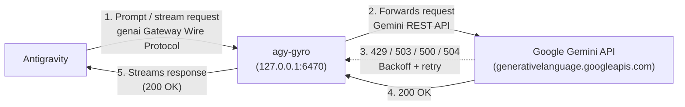

<p align="center">
  
</p>

# agy-gyro

> **Disclaimer**: `agy-gyro` is an independent open-source project and is not affiliated with, endorsed by, or sponsored by Google or the Antigravity team.

`agy-gyro` is a high-performance, lightweight local **Antigravity Enterprise Gateway** and retry proxy written in Rust. It forwards Antigravity's Enterprise Gateway `genai` wire protocol requests to standard Google Gemini API endpoints (`generativelanguage.googleapis.com`) and stabilizes Antigravity against transient API errors.


## Motivation

### 1. First-Class Enterprise Gateway Mode vs Raw Gemini API Key Mode

Raw Gemini API key mode (`"modelProvider": "gemini"`) is only officially supported in the Antigravity CLI (`agy`), and many first-class features and latest models are incomplete or unavailable in that mode.

By contrast, [Antigravity Enterprise Gateway](https://docs.cloud.google.com/gemini/enterprise/docs/ai-developer-tools/deploy-enterprise-gateway) is a first-class integration mode supported across all Antigravity products. `agy-gyro` acts as a local Enterprise Gateway server that forwards `genai` gateway wire protocol requests to standard Gemini API endpoints.

### 2. Transient API Errors & Lack of Retries

When interacting with the Google Gemini API directly using an API key, requests occasionally fail due to transient infrastructure errors or capacity limits:

- **HTTP 429 (`RESOURCE_EXHAUSTED`)**: Rate limits (RPM/TPM) or temporary backend capacity spikes.
- **HTTP 503 (`UNAVAILABLE`)**: Model servers temporarily overloaded.
- **HTTP 500 / 502 / 504**: Transient backend gateway or server errors.
- **HTTP 408 / Transport Drops**: Network timeouts or aborted socket connections.

By default, Antigravity does not implement automatic retry loops with exponential backoff. When an error status code is encountered, Antigravity terminates the active session immediately, disrupting the agentic workflow.

<p align="center">
  <br/>
  <em>The dreaded "Agent execution terminated" error</em>
</p>

`agy-gyro` solves this by catching transient errors, retrying the requests internally using exponential backoff with jitter (following the [Gemini API Troubleshooting Guide](https://ai.google.dev/gemini-api/docs/troubleshooting)), and only returning the final result to Antigravity once resolved (or when retry attempts are exhausted).



## Installation

Install `agy-gyro` using `cargo`:

```bash
cargo install agy-gyro
```

Prebuilt executables for Linux, macOS, and Windows are also available in the [latest GitHub release](https://github.com/topjohnwu/agy-gyro/releases/latest).

## Usage

`agy-gyro` runs a single persistent background daemon (`127.0.0.1:6470` by default) shared across all Antigravity instances, tracking each session's token usage, request stats, and estimated cost independently.

Before launching, provide your Gemini API key via `GEMINI_API_KEY` (or persist `api_key` in `~/.gemini/config/agy-gyro.toml`):

```bash
export GEMINI_API_KEY="your-gemini-api-key"
```

When launching any Antigravity client (`agy-gyro` or `agy-gyro app`), `agy-gyro` automatically ensures the background daemon is running, injects the Enterprise Gateway environment variables (`AGY_LLM_GATEWAY_*`), and transparently forwards any trailing arguments.

### Launching Antigravity CLI (`agy`)

Running `agy-gyro` (when the first argument is not `app`, `server`, `stop`, or `monitor`) launches `agy` in-place. It also automatically sets `AGY_ENABLE_HUB=1`, unlocking Antigravity's local Hub web interface (`--hub`, which requires Enterprise Gateway mode):

```bash
# Launch agy connected to the agy-gyro gateway:
agy-gyro

# Pass arguments through to agy:
agy-gyro --dangerously-skip-permissions

# Launch Antigravity's local Hub web UI:
agy-gyro --hub [--hub-port 4400]
```

### Launching Antigravity Desktop App (`agy-gyro app`)

Running `agy-gyro app` launches the Antigravity desktop application detached (tracked as `#app Antigravity` in `agy-gyro monitor`):

```bash
# Launch the Antigravity desktop app connected to agy-gyro:
agy-gyro app

# Pass arguments through to the Antigravity desktop app:
agy-gyro app --headless
```

By default, `agy-gyro app` locates the desktop app automatically:
- **macOS**: Launches via LaunchServices (`open -b com.google.antigravity`), preserving native macOS permissions and bundle discovery (or `open -a <app_path>` when a `.app` bundle path is configured).
- **Linux / Windows**: Auto-discovers standard install locations and `PATH` (overridable via `app_path` or `AGY_GYRO_APP_PATH`).

> **Notes for Desktop App**:
> - Antigravity enforces a single-instance lock. If the desktop app is already running without `agy-gyro`, quit the existing app completely before running `agy-gyro app` so the fresh launch picks up the gateway environment variables.
> - Antigravity merges your login shell environment (`~/.zshrc`, `~/.bash_profile`, etc.) over inherited process environment variables when starting its bundled language server. Avoid exporting stale `AGY_LLM_GATEWAY_*` variables in your shell rc files.

### Live Usage & Cost TUI Dashboard (`agy-gyro monitor`)

`agy-gyro monitor` provides an interactive TUI frontend for real-time token usage, request statistics, estimated USD costs, and gateway logs (use `Tab` or `←`/`→` to switch between `[All Sessions]` and individual sessions, `r` to reset stats, and `b` to toggle full SSE buffering at runtime):

```bash
agy-gyro monitor
```

### Managing the Background Daemon (`agy-gyro server` / `agy-gyro stop`)

You can also start or stop the background daemon explicitly without launching Antigravity:

```bash
# Start the background daemon without launching Antigravity:
agy-gyro server

# Stop the background daemon at any time:
agy-gyro stop
```

## Configuration

Settings are resolved in order of precedence: **Environment variables > `~/.gemini/config/agy-gyro.toml` > Defaults**.

| Config Key (`agy-gyro.toml`) | Environment Variable | Default     | Description                                              |
| :--------------------------- | :------------------- | :---------- | :------------------------------------------------------- |
| `host`                       | `AGY_GYRO_HOST`      | `127.0.0.1` | Host address to bind or connect to the gateway server    |
| `port`                       | `AGY_GYRO_PORT`      | `6470`      | Port to listen on or connect to (`0` = OS-assigned port) |
| `api_key`                    | `GEMINI_API_KEY`     | _None_      | Gemini API key for authenticating upstream requests      |
| `agy_path`                   | `AGY_GYRO_AGY_PATH`  | `agy`       | Executable path for Antigravity CLI                      |
| `app_path`                   | `AGY_GYRO_APP_PATH`  | _Auto_      | Path to `Antigravity.app` (macOS) or desktop executable  |
| `log_file`                   | _TOML only_          | _None_      | Path to log file for daemon proxy tracing logs           |
| `max_retries`                | _TOML only_          | `15`        | Maximum number of retry attempts for retriable errors    |
| `initial_delay_ms`           | _TOML only_          | `1000`      | Initial retry backoff delay in milliseconds              |
| `max_delay_ms`               | _TOML only_          | `60000`     | Maximum backoff delay cap in milliseconds                |
| `no_jitter`                  | _TOML only_          | `false`     | Disable randomized jitter in backoff calculation         |
| `buffer`                     | _TOML only_          | `false`     | Enable full stream chunk buffering (toggleable in `monitor`) |
| `request_timeout_secs`       | _TOML only_          | `600`       | Timeout per attempt in seconds                           |

### Configuration File (`~/.gemini/config/agy-gyro.toml`)

You can persist your API key and preferred settings in `~/.gemini/config/agy-gyro.toml`:

```toml
api_key = "your-gemini-api-key"
max_retries = 15
log_file = "/tmp/gyro.log"
```

## Streaming & Error Recovery Behavior

### Default Mode: Streaming Passthrough (`buffer = false`)

In default mode, `agy-gyro` verifies Chunk 1 and immediately streams subsequent tokens to minimize time-to-first-token latency:
- **Chunk 1 Error**: Retried seamlessly before sending headers to Antigravity.
- **Mid-Stream Error (Chunk $N > 1$)**: Forwarded downstream to prevent duplicated tokens.

### Full Stream Buffering Mode (`buffer = true`)

When `buffer = true` in `~/.gemini/config/agy-gyro.toml` (or toggled live by pressing `b` in `agy-gyro monitor`), `agy-gyro` buffers all incoming stream chunks before delivering them to Antigravity:
1. **Full Verification**: Ensures every chunk in the response is error-free and that the upstream stream completes cleanly.
2. **Zero-Byte Leakage**: If an error (e.g. `503 UNAVAILABLE`, `429 RESOURCE_EXHAUSTED`, or network disconnect) occurs at chunk 1 or mid-stream, `agy-gyro` discards the buffered chunks and replays the request from scratch.
3. **Automatic Keep-Alive Heartbeats**: If buffering or retry backoff exceeds 15 seconds, `agy-gyro` commits `200 OK` headers and streams periodic keep-alive heartbeats (`: keep-alive\n\n` for SSE) while continuing to buffer and retry in the background.
4. **Flawless Delivery**: Antigravity only receives verified, complete streams without partial output or syntax errors.

## License

This project is licensed under the [MIT License](LICENSE).
