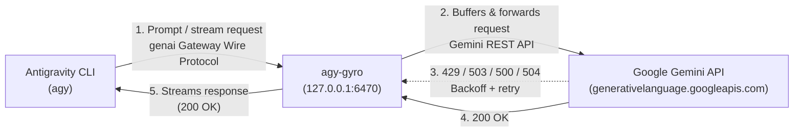

<p align="center">
  
</p>

# agy-gyro

> **Disclaimer**: `agy-gyro` is an independent open-source project and is not affiliated with, endorsed by, or sponsored by Google or the Antigravity team.

`agy-gyro` is a high-performance, lightweight local **Antigravity Enterprise Gateway** and retry proxy written in Rust. It forwards Antigravity's Enterprise Gateway `genai` wire protocol requests to standard Google Gemini API endpoints (`generativelanguage.googleapis.com`) and stabilizes the Antigravity CLI (`agy`) against transient API errors.


## Motivation

### 1. First-Class Enterprise Gateway Mode vs Raw Gemini API Key Mode

While Antigravity supports a Gemini API key mode (`"modelProvider": "gemini"`), many first-class features and latest models are incomplete or unavailable in that mode.

By contrast, [Antigravity Enterprise Gateway](https://docs.cloud.google.com/gemini/enterprise/docs/ai-developer-tools/deploy-enterprise-gateway) is a first-class integration mode across `agy` and IDE extensions. `agy-gyro` acts as a local Enterprise Gateway server that forwards `genai` gateway wire protocol requests to standard Gemini API endpoints.

### 2. Transient API Errors & Lack of Retries

When interacting with the Google Gemini API directly using an API key, requests occasionally fail due to transient infrastructure errors or capacity limits:

- **HTTP 429 (`RESOURCE_EXHAUSTED`)**: Rate limits (RPM/TPM) or temporary backend capacity spikes.
- **HTTP 503 (`UNAVAILABLE`)**: Model servers temporarily overloaded.
- **HTTP 500 / 502 / 504**: Transient backend gateway or server errors.
- **HTTP 408 / Transport Drops**: Network timeouts or aborted socket connections.

By default, the Antigravity CLI (`agy`) does not implement automatic retry loops with exponential backoff. When an error status code is encountered, `agy` terminates the active session immediately, disrupting the agentic workflow.

<p align="center">
  <br/>
  <em>The dreaded "Agent execution terminated" error</em>
</p>

`agy-gyro` solves this by catching transient errors, retrying the requests internally using exponential backoff with jitter (following the [Gemini API Troubleshooting Guide](https://ai.google.dev/gemini-api/docs/troubleshooting)), and only returning the final result to `agy` once resolved (or when retry attempts are exhausted).



## Installation

Install `agy-gyro` using `cargo`:

```bash
cargo install agy-gyro
```

Prebuilt executables for Linux, macOS, and Windows are also available in the [latest GitHub release](https://github.com/topjohnwu/agy-gyro/releases/latest).

## Usage

`agy-gyro` runs a single persistent background daemon (`127.0.0.1:6470` by default) shared across all `agy` instances, tracking each session's token usage, request stats, and cost independently.

### Launching Antigravity (`agy`)

Running `agy-gyro` without subcommands ensures the background daemon is running, configures the environment (`AGY_LLM_GATEWAY_*` and `AGY_ENABLE_HUB=1`), and launches `agy`:

```bash
export GEMINI_API_KEY="your-gemini-api-key"

# Launch agy connected to the agy-gyro gateway:
agy-gyro

# Pass arguments directly through to agy:
agy-gyro -- --dangerously-skip-permissions
```

### Live Usage & Cost TUI Dashboard (`agy-gyro monitor`)

`agy-gyro monitor` provides an interactive TUI frontend for real-time token usage, request statistics, estimated USD costs, and gateway logs (use `Tab` or `←`/`→` to switch between `[All Sessions]` and individual `agy` sessions):

```bash
# Connect to the default gateway port (127.0.0.1:6470, or port configured in agy-gyro.toml):
agy-gyro monitor

# Or connect to a specific port or URL:
agy-gyro monitor --port 9090
agy-gyro monitor --url http://127.0.0.1:9090
```

### Managing the Background Daemon (`agy-gyro server` / `agy-gyro stop`)

While running `agy-gyro` starts the daemon automatically, you can also start or stop the background daemon explicitly:

```bash
# Start the background daemon without launching agy:
agy-gyro server

# Stop the background daemon at any time:
agy-gyro stop
```

### Antigravity Hub Web UI (`--hub`)

`agy-gyro` automatically sets `AGY_ENABLE_HUB=1` when launching `agy`, unlocking Antigravity's local Hub web interface (which requires Enterprise Gateway mode):

```bash
agy-gyro -- --hub [--hub-port 4400]
```

Once the server is running, open the Hub UI in your browser with `?useWebSocket=true`:

```text
http://localhost:4400/?useWebSocket=true
```

> **Important**: Always include `?useWebSocket=true` when accessing the Hub UI over `http://localhost:4400`. Without it, the web UI opens multiple long-lived HTTP/1.1 streaming RPCs that exhaust the browser's 6-connection-per-origin limit and cause the UI to stall when switching or starting conversations. With `?useWebSocket=true`, all RPC streams are multiplexed over a single WebSocket connection.

## Configuration

### Options & Flags

Options are resolved in order of precedence: **CLI flags > Environment variables > `~/.gemini/config/agy-gyro.toml` > Defaults**.

| Flag                     | Environment Variable            | Config Key (`agy-gyro.toml`) | Default                                     | Description                                             |
| :----------------------- | :------------------------------ | :--------------------------- | :------------------------------------------ | :------------------------------------------------------ |
| `-H`, `--host`           | `AGY_GYRO_HOST`                 | `host`                       | `127.0.0.1`                                 | Host address to bind the gateway server                 |
| `-p`, `--port`           | `AGY_GYRO_PORT`                 | `port`                       | `6470`                                      | Port to listen on or connect to (`0` = OS-assigned port)|
| `-u`, `--upstream`       | `AGY_GYRO_UPSTREAM_URL`         | `upstream`                   | `https://generativelanguage.googleapis.com` | Target upstream Gemini API base URL                     |
| `--api-key`              | `GEMINI_API_KEY`                | `api_key`                    | _Required_                                  | Gemini API key for authenticating upstream requests     |
| `--agy-path`             | `AGY_GYRO_AGY_PATH`             | `agy_path`                   | `agy`                                       | Executable path for Antigravity CLI                     |
| `--log-file`             | `AGY_GYRO_LOG_FILE`             | `log_file`                   | _None_                                      | Path to log file for daemon proxy tracing logs          |
| `--max-retries`          | `AGY_GYRO_MAX_RETRIES`          | `max_retries`                | `15`                                        | Maximum number of retry attempts for retriable errors   |
| `--initial-delay-ms`     | `AGY_GYRO_INITIAL_DELAY_MS`     | `initial_delay_ms`           | `1000`                                      | Initial retry backoff delay in milliseconds             |
| `--max-delay-ms`         | `AGY_GYRO_MAX_DELAY_MS`         | `max_delay_ms`               | `60000`                                     | Maximum backoff delay cap in milliseconds               |
| `--no-jitter`            | `AGY_GYRO_NO_JITTER`            | `no_jitter`                  | `false`                                     | Disable randomized jitter in backoff calculation        |
| `--no-buffer`            | `AGY_GYRO_NO_BUFFER`            | `no_buffer`                  | `false`                                     | Disable full stream buffering (stream chunks immediately)|
| `--request-timeout-secs` | `AGY_GYRO_REQUEST_TIMEOUT_SECS` | `request_timeout_secs`       | `600`                                       | Timeout per attempt in seconds                          |

### Configuration File (`~/.gemini/config/agy-gyro.toml`)

You can persist your API key and preferred settings in `~/.gemini/config/agy-gyro.toml`:

```toml
api_key = "your-gemini-api-key"
max_retries = 15
log_file = "/tmp/gyro.log"
```

## Streaming & Error Recovery Behavior

### Default Mode: Full Stream Buffering

In default mode, `agy-gyro` buffers all incoming stream chunks before delivering them to `agy`:
1. **Full Verification**: Ensures every chunk in the response is error-free and that the upstream stream completes cleanly.
2. **Zero-Byte Leakage**: If an error (e.g. `503 UNAVAILABLE`, `429 RESOURCE_EXHAUSTED`, or network disconnect) occurs at chunk 1 or mid-stream, `agy-gyro` discards the buffered chunks and replays the request from scratch.
3. **Automatic Keep-Alive Heartbeats**: If buffering or retry backoff exceeds 15 seconds, `agy-gyro` commits `200 OK` headers and streams periodic keep-alive heartbeats (`: keep-alive\n\n` for SSE) to satisfy `agy`'s 60-second `ResponseHeaderTimeout` while continuing to buffer and retry in the background.
4. **Flawless Delivery**: `agy` only receives verified, complete streams without partial output or syntax errors.

### Passthrough Mode (`--no-buffer`)

When running with `--no-buffer`, `agy-gyro` verifies Chunk 1 and immediately streams subsequent tokens to minimize time-to-first-token latency:
- **Chunk 1 Error**: Retried seamlessly before sending headers to `agy`.
- **Mid-Stream Error (Chunk $N > 1$)**: Forwarded downstream to prevent duplicated tokens.

## License

This project is licensed under the [MIT License](LICENSE).
